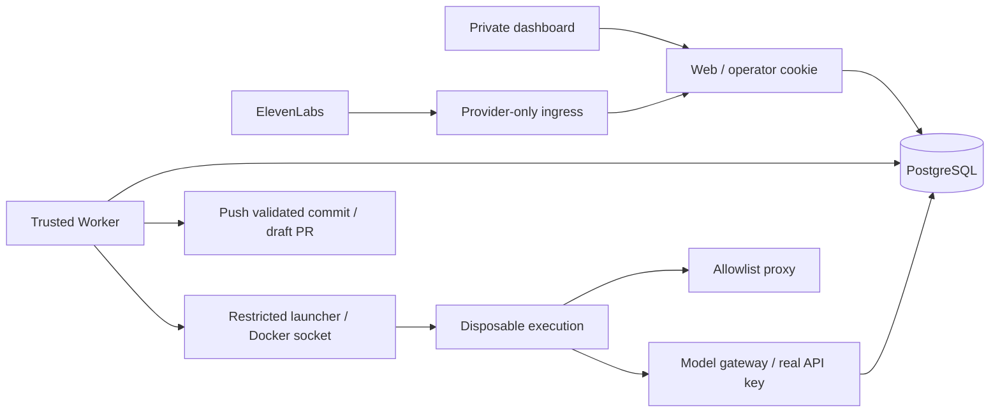

# Architecture

Structure and rationale.

File tree, stack, commands: [README](../README.md). Non-obvious decisions follow.

---

## The core data flow

```
Browser tab
  │
  ├─ POST /api/sessions          → creates session, returns ID
  ├─ GET  /api/sessions/:id/events  → opens SSE stream (stays open)
  └─ useConversation (ElevenLabs SDK) → WebSocket to ElevenLabs

ElevenLabs Agent (Claude LLM + voice)
  └─ during the call, calls tool webhooks:
       POST /api/tools/{name}   → src/app/api/tools/[name]/route.ts
                                → toolRegistry.dispatch(name, req)
                                → src/lib/api/tool-registry.ts
       (tool names: list-files, read-file, search-code,
        save-decision, flag-question, generate-spec)

ElevenLabs platform (after the call)
  └─ POST /api/agent/post-call   → durable Webhook receipt → worker finalization

Browser tab (user clicks "Build It")
  └─ POST /api/sessions/:id/build → durable Build Attempt → worker, streams via SSE
```

Mutation tools use the configured Session repository; list/search stay read-only. PostgreSQL commits Session state and ordered events in one transaction. `LISTEN/NOTIFY` only wakes SSE readers; `Last-Event-ID` enables dashboard replay.

---

## Why SSE, not WebSockets

This Next.js App Router version cannot upgrade API routes to WebSockets. Its HTTP server exposes no raw socket compatible with the `ws` upgrade handshake.

SSE over `ReadableStream` + `TransformStream` works natively in App Router without external dependencies. [src/app/api/sessions/[id]/events/route.ts](../src/app/api/sessions/%5Bid%5D/events/route.ts) drains durable replay pages, awaits writes for backpressure, and polls missed notifications. Browsers send user intent—start call, trigger build—through normal POSTs. SSE covers the remaining server-to-client push.

**Constraint to remember:** SSE is unidirectional. Browsers cannot write to the stream; all browser actions use separate `POST` requests.

---

## Why `globalThis` for singletons

The shared singleton helper preserves process-level adapters across hot reloads:

- `SessionStore` — synchronous in-memory adapter for tests and deliberate development mode
- Test `CodeSource` registry — explicit in-memory overrides, not a repository-content cache
- The runtime PostgreSQL pool — shared by web repositories and queues

Next.js development hot reloads would reset module-level stores and lose Session state. `globalThis` survives module re-evaluation within the same Node.js process.

`src/lib/singleton.ts` and `src/lib/db/postgres.ts` centralize this pattern. Separate worker processes own and close their pools.

---

## Why no RAG, no embeddings, no vector database

Typical codebase AI chunks code, embeds it in a vector DB, then retrieves relevant chunks at query time.

SpecVoice instead gives Claude on-demand tools: `list_files` for orientation, `read_file` for needed content, `search_code` for usages. Discovery stays explicit and inspectable; profiling supplies bounded size metadata without embeddings.

Benefits:

- No semantic indexing, vector DB, or embedding costs
- Agent selects files relevant to the current question; similarity search does not choose them
- Audit trail—files read, decisions logged—is a first-class feature

Constraint: file reads cap at 4000 characters; entire large files cannot enter context at once. Deliberate navigation grounds the Spec in inspected content, recorded in `session.filesRead`.

---

## Why ElevenLabs tools are standalone entities

ElevenLabs separates:

- **Tools** — standalone API resources, created via `client.conversationalAi.tools.create()`
- **Agent config** — references tools by their IDs in `prompt.toolIds`

The REST API reference implies inline definitions. Separate resources provide cleaner ownership:

- Tools can be updated independently of the agent config
- `setup-agent.ts` idempotently creates missing tools, updates existing tools, then updates the agent with the full `toolIds` list
- `toolIds` replaces the entire list; partial lists silently remove omitted tools, never merge

One dynamic route, `src/app/api/tools/[name]/route.ts`, reads `name` and calls `toolRegistry.dispatch(name, req)`. `src/lib/api/tool-registry.ts` registers one handler per tool name. Shared Session lookup and Zod validation live in `src/lib/api/tool-handler.ts`.

Three distinct responsibilities:

- **ElevenLabs tool config** (webhook URL, description, parameter schema as sent to ElevenLabs): `src/lib/agent/tool-definitions.ts`
- **Server handler logic** (session lookup, validation, side effects): `src/lib/api/tool-registry.ts`
- **Route dispatch** (thin adapter reading `name`, calling registry): `src/app/api/tools/[name]/route.ts`

Never put handler logic in routes or ElevenLabs schema config in the registry.

---

## How session capabilities travel from browser to tool webhook

A revocable operator cookie protects saved Session history and dashboard routes. Call start requests a private ElevenLabs signed URL and issues a fresh capability bound to the Session and Voice call. The browser passes `dynamicVariables: { session_id: session.id, session_token: capability, call_id: callId }`. ElevenLabs retains these variables for tools and signed completion callbacks.

Tool parameter schemas wire both values through `dynamicVariable` fields:

```typescript
const SESSION_ID_PROP = {
  type: LiteralJsonSchemaPropertyType.String,
  dynamicVariable: 'session_id',
}

const SESSION_TOKEN_PROP = {
  type: LiteralJsonSchemaPropertyType.String,
  dynamicVariable: 'session_token',
}
```

During calls, ElevenLabs injects both values into every outbound webhook body. Handlers verify the capability before Session lookup. Capabilities never enter the `Session` object or generated Spec.

`dynamicVariable` extends JSON Schema; ElevenLabs' server tools guide omits it. Discovery: [elevenlabs-sdk-holes.md §9](./elevenlabs-sdk-holes.md).

---

## How the dashboard stays in sync

`useSession` in [src/components/hooks/useSession.ts](../src/components/hooks/useSession.ts) owns dashboard state:

1. Opens an `EventSource` to `/api/sessions/:id/events`
2. Replaces the full Session object in React state on `session_updated` (no diffing)
3. Keeps `build_progress` entries in a separate `buildLog` array, outside the `Session` object
4. Keeps native EventSource reconnect behavior and its Last-Event-ID cursor
5. Cleans up the `EventSource` on unmount

**`session_updated` carries all state**. `call_ended`, `build_complete`, and `build_failed` are signals, not authoritative state. Render the latest Session object; never derive state from signals.

---

## Code source abstraction

Production `CodeSource` implementations, plus an in-memory fixture adapter:

- `GitHubCodeSource` — reads via Octokit; requires `GITHUB_TOKEN` for private repos
- `LocalCodeSource` — reads committed Git objects under `repoLocalPath`; excludes dirty and untracked files. Public Session creation accepts paths only below `SPECVOICE_LOCAL_REPO_ROOT`; rejects traversal and symlink escapes.

`resolveCodeSource(session)` in [src/lib/code/index.ts](../src/lib/code/index.ts) selects from Session state. Route handlers never instantiate sources directly.

Both adapters pin commits at Session creation. Missing commits fail; never silently repin. GitHub reads use that SHA. Confirmed Scope Plans wrap code tools, confining discovery to approved roots. Repository operations enforce scope and budgets. Builds sparsely check out the same SHA and validate every new commit's changed paths before publication. See [Repository scale](./repository-scale.md).

Local discovery reads pinned `.gitignore` rules. Both adapters apply default rules through npm `ignore` ([src/lib/code/ignore-rules.ts](../src/lib/code/ignore-rules.ts)). Never skip this filter or write custom glob matching.

---

## Build pipeline placement

Builds run strictly post-call, never during voice conversations:

1. Only `generate_spec` produces `session.specOutput`; the agent calls it at conversation end
2. Multi-turn Claude Code CLI execution during a call would add unpredictable webhook latency
3. The complexity gate reads `session.filesRead` and `session.openQuestions`; it needs complete call state

Implementation and phases: [build-pipeline.md](./build-pipeline.md).

Session routes use operator cookies; tool webhooks use call capabilities. Production requires PostgreSQL. Memory mode serves tests and UI/discovery development; default Builds require the durable isolated runtime.

## Execution and recovery seams

The trusted Worker runs independent Build, profile, receipt and maintenance lanes. PostgreSQL owns claims, renewed leases and ordered events. Post-call finalization commits Call, Session, receipt and events together. The Build Attempt interface owns publication reconciliation; unknown generation never replays automatically.



Execution receives regular scoped source files and returns a bounded patch. The Worker applies it in its fresh Git checkout and validates paths before publication. Only the launcher holds the Docker socket; only the gateway holds the real model key. Fixed-image/container limits and attempt credentials constrain hostile code; Docker still shares the host kernel. See [execution details](agents/claude-code.md).

Session transactions apply retention while preserving immutable planning records. Encrypted backups stream to a second disk/NAS. Restore applies retention and revokes restored logins before startup. Restored queued attempts count as uncertain generation: they may have run since backup. See [restore policy](backups.md).
